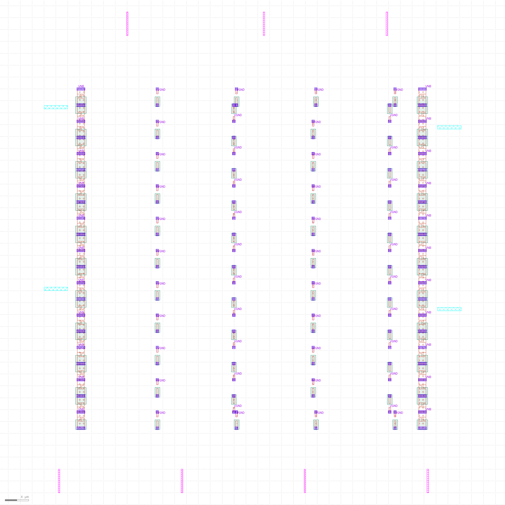
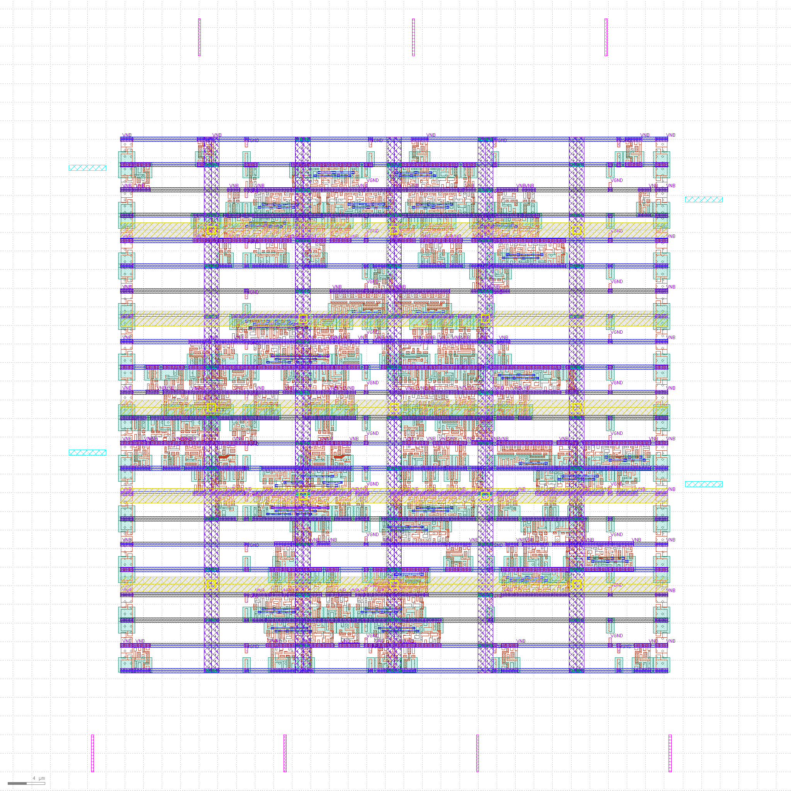
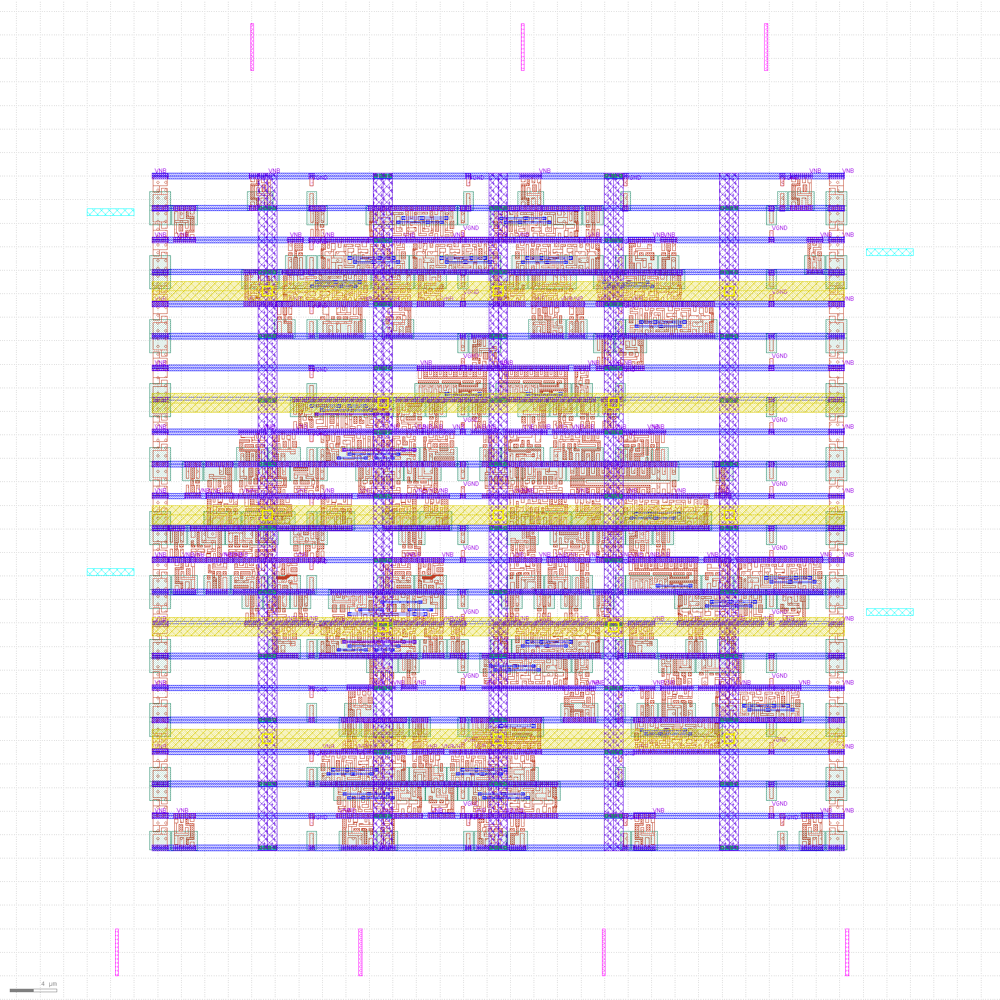
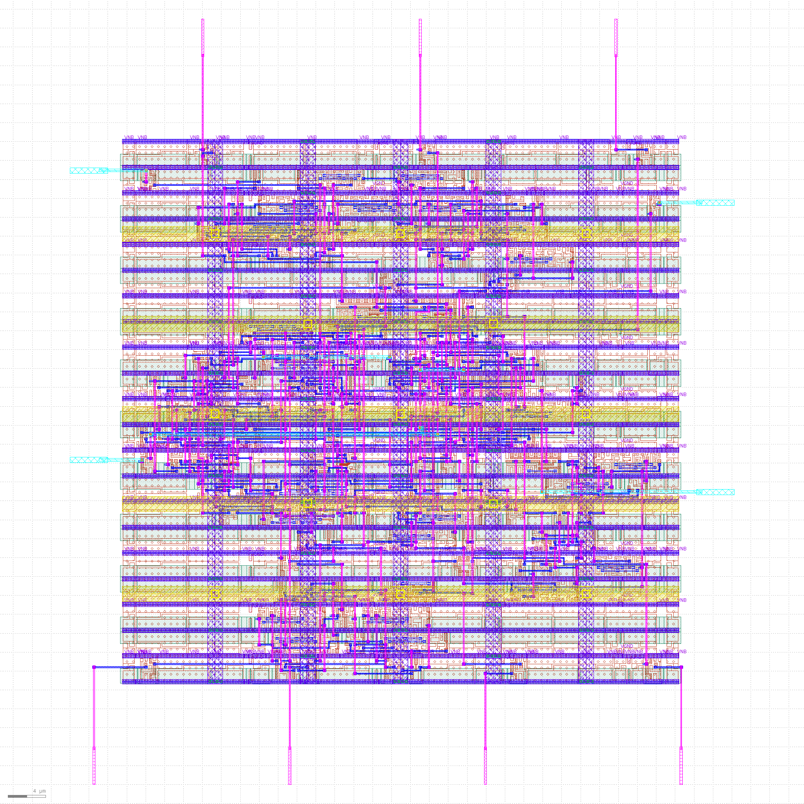
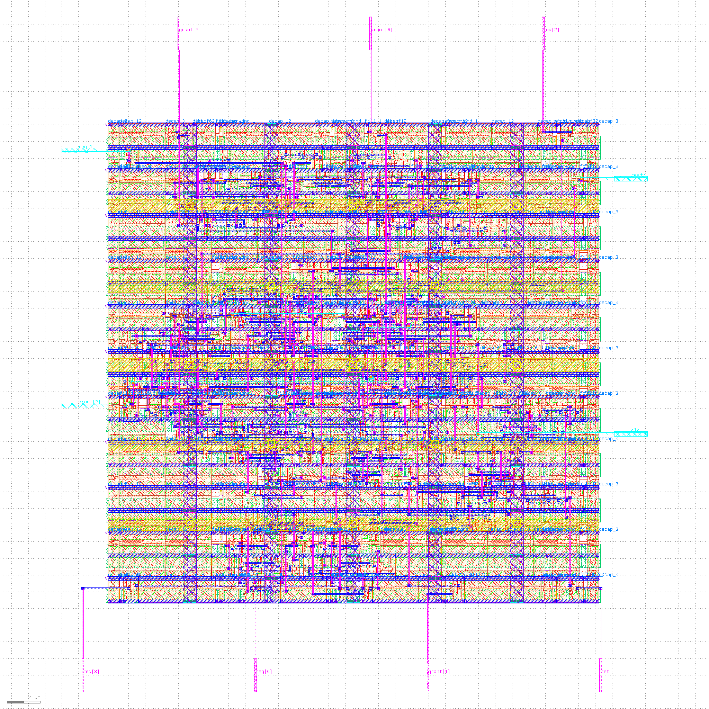

# Starvation-Aware Round-Robin Arbiter

## Project Overview
Design and Multi-Corner Static Timing Analysis of a
Starvation-Aware Round-Robin Arbiter Using Open-Source VLSI Tools.

The design supports four requesters and combines round-robin
selection with request aging to prioritize requests that reach
a configured age threshold.

## Tools
- Verilog HDL
- Icarus Verilog and GTKWave
- Yosys
- OpenLane
- OpenSTA
- SkyWater SKY130 standard-cell library

## Design Configuration
- Requesters: 4
- Age counter width: 2 bits for the physical implementation candidate
- Age threshold: 3
- Clock period used for STA: 10 ns

## Functional Verification
The age-width functional test completed successfully:
- 292 protocol checks
- One-hot grant checks
- Request/grant consistency checks
- Ready/backpressure behavior
- Idle and single-request cases
- Random input patterns
- Reset behavior

Log: `evidence/sim/age_width_functional.log`

## Formal Verification
Bounded SAT checks at 10 and 30 cycles report success.
These are bounded checks and do not constitute an unbounded proof
of starvation freedom.

## Physical Design
OpenLane physical implementation completed. See the evidence files
for implementation reports and physical verification results.

### Physical Implementation Metrics

| Metric | Result |
|---|---:|
| Standard-cell count | 102 |
| Die area | 0.004392 mm² |
| Routing violations | 0 |
| Magic DRC violations | 0 |
| LVS mismatches | 0 |

These results correspond to the 2-bit age-counter physical implementation candidate.

### Physical Design Evidence

#### Floorplan

#### Placement

#### Clock Tree Synthesis

#### Routing

#### Final Layout

## Multi-Corner Static Timing Analysis
| Corner | Operating Point | Reported Worst Slack | TNS |
|---|---|---:|---:|
| SS | 100 C, 1.60 V | +4.14 ns | 0.00 ns |
| TT | 25 C, 1.80 V | +6.17 ns | 0.00 ns |
| FF | -40 C, 1.95 V | +6.91 ns | 0.00 ns |

These are reported standalone OpenSTA results using the CTS netlist
and routed SPEF. Liberty operating-condition and tap-cell model
warnings remain; results should not be treated as sign-off timing.

Detailed report:
`evidence/multicorner_sta/MULTICORNER_STA_REPORT.md`

## Repository Structure
- `rtl/` — RTL design variants
- `tb/` — simulation testbenches
- `submission/` — submission RTL and testbench files
- `evidence/` — simulation, formal, physical-design and STA evidence

## Demonstration Video
Video link: To be added after recording and uploading.

## Conclusion
This project demonstrates RTL design, functional simulation,
bounded formal checking, physical implementation, and multi-corner
static timing analysis using open-source VLSI tools.
